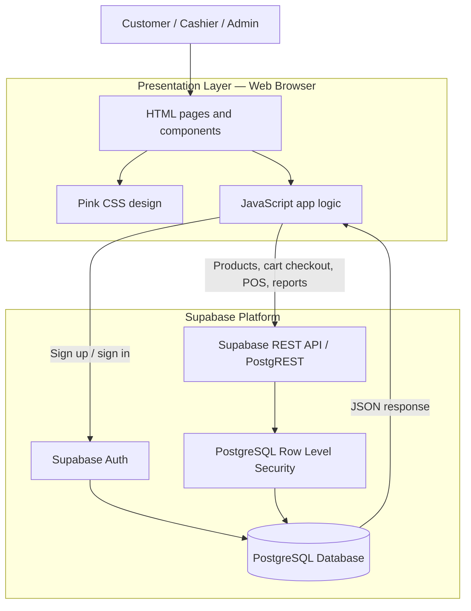
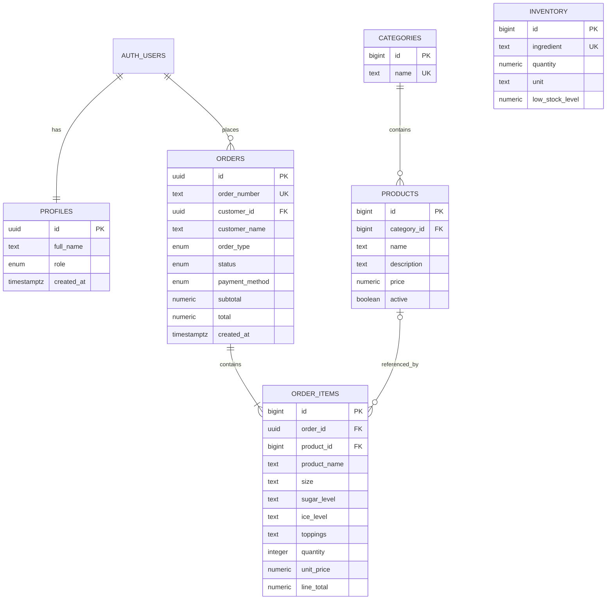

# Teariffic — Milk Tea Shop Web Application

Pink-themed milk tea ordering + shop management web app using **HTML, CSS, JavaScript and Supabase (PostgreSQL + Auth + Row Level Security)**.

## 1. Project structure

```text
teariffic_supabase/
├── index.html
├── README.md
├── assets/
│   ├── app.js
│   ├── config.js
│   └── style.css
└── sql/
    └── schema.sql
```

## 2. System architecture design



### Architecture explanation

1. **Presentation layer:** HTML provides the application structure, CSS creates the responsive pink interface, and JavaScript handles navigation, cart operations, form validation, and Supabase requests.
2. **Backend services layer:** Supabase Auth manages user sessions. Supabase's API exposes database operations to the browser. Row Level Security (RLS) checks each request against the signed-in user and role.
3. **Data layer:** PostgreSQL stores profiles, categories, products, inventory, orders, and order items.
4. **Security:** The browser uses only the Supabase project URL and anon/public key. RLS protects data. Never expose the `service_role` key in frontend code.

## 3. Database design



### Main database relationships

- `auth.users` 1:1 `profiles`: every Supabase account has a profile and role.
- `profiles` 1:many `orders`: a signed-in user can place many orders.
- `categories` 1:many `products`: each product can belong to one category.
- `orders` 1:many `order_items`: each order contains its selected drinks.
- `products` 1:many `order_items`: order items optionally reference a product; product name and price are also snapshotted on the order item.
- `inventory` tracks ingredients and low-stock thresholds.

## 4. Features included

### Customer website
- Responsive home page and menu.
- Product category filters.
- Drink customization: Regular/Large, sugar level, ice level, toppings.
- Shopping cart saved in browser local storage.
- Customer sign up and sign in through Supabase Auth.
- Checkout for pickup or dine-in.
- Cash or GCash payment-method selection (record only; no payment gateway).
- Customer order history and order status.

### Staff / admin
- Dashboard with today's order count and revenue.
- Order status updates.
- Cashier POS for walk-in sales.
- Product add / hide / show.
- Inventory list and low-stock alerts.
- Basic recent sales report.
- Staff role support.

## 5. Setup instructions (Supabase)

1. Create a project at [Supabase](https://supabase.com/).
2. Open **SQL Editor → New query**.
3. Paste and run all of `sql/schema.sql`.
4. Open **Project Settings → API** (or Connect) and copy the Project URL and anon/public key.
5. Open `assets/config.js` and replace the placeholders:

```js
window.TEARRIFIC_SUPABASE_URL = "https://your-project-ref.supabase.co";
window.TEARRIFIC_SUPABASE_ANON_KEY = "your-anon-public-key";
```

6. In Supabase **Authentication → URL Configuration**, add your local app URL to the allowed redirect URLs if you enable email confirmation. For example, `http://localhost:5500/**` or the exact local URL you use.
7. Create an account through the app. If email confirmation is enabled, confirm the email before signing in.
8. To make the first account the administrator, find its UUID in **Authentication → Users**, then run this in SQL Editor:

```sql
update public.profiles
set role = 'admin'
where id = 'PASTE-THE-AUTH-USER-UUID-HERE';
```

9. Run the app using a local web server. For example, with VS Code Live Server, open `index.html`. Or use Python's local static server from the project directory:

```bash
python -m http.server 5500
```

Then visit `http://localhost:5500`.

> Supabase is hosted, so WAMP is not required. If you prefer to serve the static files through Apache in WAMP, copy the folder into `www/teariffic_supabase/` and visit `http://localhost/teariffic_supabase/`.

## 6. Test checklist

- [ ] Home page and menu load after Supabase configuration.
- [ ] Create a customer account and sign in.
- [ ] Add a drink, customize it, and change quantity in cart.
- [ ] Place a pickup or dine-in order.
- [ ] Confirm the order appears in My Orders.
- [ ] Promote a trusted account to admin using SQL Editor.
- [ ] Sign in as admin and verify dashboard / order updates.
- [ ] Add a product and confirm it appears in the public menu.
- [ ] Add inventory and verify low-stock alert.
- [ ] Create a cashier account in Supabase Auth, then set its profile role to `cashier`.

## 7. Important production notes

This is a functional learning-project starter, not a payment-certified or production-hardened POS. Before real deployment:
- Move order creation and price calculation into a trusted PostgreSQL function (RPC) or server-side backend. The browser currently recalculates prices from the catalog but a determined user can still manipulate client requests.
- Use a database transaction for order + item creation. The current browser flow attempts to delete the order if item insertion fails, but production should use one transaction/RPC.
- Add audit logs, backups, rate limiting, email verification, and proper staff onboarding.
- GCash is only a recorded payment choice; integrate an approved payment provider to accept online payments.
- Inventory is manually tracked in this starter. Add recipe/ingredient consumption rules if inventory should automatically decrement after sales.

## 8. Roles

- `customer`: browse menu, place orders, see their own orders.
- `cashier`: use POS and view/update shop orders.
- `admin`: manage products and inventory, view reports, and manage shop operations.

RLS is enabled on all application tables. The SQL file includes the policies used by this starter.
